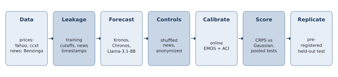
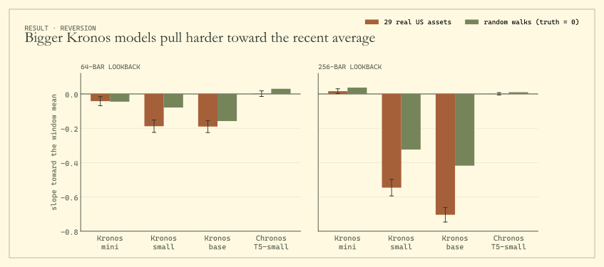
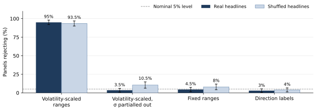

# P-Quant: kronos-agent audit harness

A research harness, with configs and pre-registrations, for auditing zero-shot financial foundation
models and LLM news signals under leakage controls.

Foundation models for price series (Kronos, Chronos) and LLMs that read news are now cheap to run
zero-shot, and each comes with reported forecasting gains. Each is also exposed to look-ahead bias,
training-data contamination and design choices that leak signal. This repository is the harness we used
to test them under controls designed to catch those failure modes. The study started as an attempt to fuse
Kronos's sampled price paths with an LLM's reading of timestamped news; the controls kept catching gains
that were not real, and the results below are what survived.

**Short answer:** nothing did. Under the controls, neither the foundation models nor the LLM news signal
gave a forecasting edge we could confirm, and the one signal that looked real came from how the question
was asked.



---

## Contents
1. [What is tested](#what-is-tested)
2. [The audit protocol](#the-audit-protocol)
3. [Method in brief](#method-in-brief)
4. [Main results](#main-results)
5. [Repository layout](#repository-layout)
6. [Installation](#installation)
7. [Running the tests](#running-the-tests)
8. [Reproducing the results](#reproducing-the-results)
9. [Pre-registrations](#pre-registrations)
10. [Data, keys and licences](#data-keys-and-licences)
11. [Known limitations](#known-limitations)
12. [Citation](#citation)

---

## What is tested

| Component | Model | How it is used |
|---|---|---|
| Price foundation model | [Kronos](https://github.com/shiyu-coder/Kronos)-base (102M), -small (24.7M), -mini (4.1M) | Zero-shot, 32 sampled OHLCV paths per forecast, fp16 on a T4 |
| Comparison model | Chronos-T5-small (46M) | Same sampling interface and evaluation as Kronos |
| News reader | Llama-3.1-8B-Instruct, 4-bit NF4 | Reads up to 25 leakage-safe Benzinga headlines; answers are read as next-token probabilities over answer letters, not generated text |
| Baselines | Gaussian with recent volatility, bootstrap, random walk | Calibrated simple references on the same dates |

Assets: SPY, QQQ, IWM and 26 US large caps (5-trading-day horizon, daily bars), plus BTC/USDT and ETH/USDT
(24-hour horizon, hourly bars). The headline period is **July 2024 to October 2026**, after both models'
training cutoffs.

## The audit protocol

Each control is implemented in code and applied to every headline result.

| Control | What it rules out | Where |
|---|---|---|
| **Dual training cutoff.** Kronos pretraining ends 2024-06, Llama-3.1 ends 2023-12; only forecasts from 2024-07 on are scored. The year before is kept as an in-sample contrast. | Memorized outcomes | `config.py`, `data.py` (`label_period`) |
| **Leakage-safe news timing.** A headline is used only if it was created *and last updated* before the information time (prior close at 20:00 UTC for equities, the forecast hour for crypto). Edited articles are dropped, not truncated. | Look-ahead through late edits | `news.py` |
| **Shuffled-news placebo.** Each forecast gets the headlines of a randomly chosen other date, with its own price context kept. A real news effect must vanish. | Effects that are not about the news | `newsrun.py` |
| **Anonymization.** Names, tickers, executives and dates are removed from the prompt. | Recall of the company instead of reading the news | `llm.py`, `newsrun.py` |
| **Pre-registration.** Hypothesis, held-out data and test fixed in a dated file before scoring, with the code frozen by hash. | Forking paths, selective reporting | `PREREGISTRATION*.md`, `confirm.py` |
| **Online, delay-aware calibration.** Every correction (EMOS, ACI, conformal) uses only outcomes realized before the forecast and resets at the training cutoff. | Calibration that peeks at the future | `conformal.py`, `phase2.py` |

Scoring uses CRPS, interval coverage and PIT for distributions and the information coefficient (IC) for
signals. Significance uses Diebold–Mariano tests with Newey–West variance and the HLN correction, pooled
tests across assets (cross-asset average per date, then Newey–West), Driscoll–Kraay standard errors for
slopes averaged across assets, Holm corrections and permutation tests (`metrics.py`, `confirm.py`).

## Method in brief

**Window-mean gap.** For a forecast made at $t$ with lookback $L$ and last close $P_t$:

$$
g_t = \log P_t - \frac{1}{L}\sum_{s=t-L+1}^{t}\log P_s
$$

The reversion slope $b$ comes from regressing the mean forecast log return $\mu_t$ on the gap,
$\mu_t = a + b\,g_t + \varepsilon_t$. A forecaster with no reversion has $b = 0$ on random walks.

**Online EMOS correction** (`conformal.py`). Each ensemble member $x_{t,j}$ is mapped to

$$
\tilde{x}_{t,j} = \alpha_t + \beta_t\,\mu_t + \gamma_t\,g_t + k_t\,(x_{t,j} - \mu_t)
$$

with $(\alpha_t, \beta_t, \gamma_t)$ from a ridge regression on the last 250 realized origins (50-origin
warm-up) and the spread factor $k_t = \sqrt{\overline{(e/s)^2}}$ matching ensemble spread $s$ to past
residuals $e$.

**Score.** Forecasts are compared on the continuous ranked probability score, estimated from the ensemble:

$$
\mathrm{CRPS}(F, y) = \mathbb{E}_F\lvert X - y\rvert - \tfrac{1}{2}\,\mathbb{E}_F\lvert X - X'\rvert
$$

The benchmark is $N(0, \hat\sigma_t^2 h)$, with $\hat\sigma_t$ the volatility of the same context window.

**Pooled news test** (`confirm.py`). Per asset, signal and realized return are z-scored; their product is
averaged across assets on each date and tested one-sided with Newey–West:

$$
d_t = \frac{1}{N_t}\sum_{i=1}^{N_t} z(\text{signal}_{it})\, z(r_{i,t+h}), \qquad H_0:\ \mathbb{E}[d_t] \ge 0
$$

**Date-clustered slopes** (`phaseb.py`). Assets share dates, so the mean slope $\bar b$ uses
Driscoll–Kraay standard errors built from each date's influence $u_t$:

$$
\widehat{\mathrm{Var}}(\bar b) = \sum_{\ell=-m}^{m}\Big(1 - \frac{|\ell|}{m+1}\Big)\sum_t u_t\,u_{t-\ell},
\qquad u_t = \frac{1}{N}\sum_{i=1}^{N}\frac{\tilde g_{it}\,\hat e_{it}}{\sum_s \tilde g_{is}^2}
$$

## Main results

**1. Kronos reverts its forecasts toward the mean price of its input window.** On SPY (5-day horizon,
256-bar lookback) the slope of the mean forecast on the gap between the last price and the window mean is
−0.64 after the cutoff and −0.98 before it. The tokenizer reconstructs prices faithfully (0.09% error), so
the reversion is learned by the model. On synthetic random walks, where the future does not depend on the
gap, Kronos forecasts against the true trend in 98–100% of series at 256 bars; Chronos does so 33–55% of
the time, close to chance.



**2. After correction, no foundation model beats a Gaussian.** Across the 29 US assets (65 scored dates
each, pooled test by date):

| Model, lookback | CRPS vs Gaussian, raw | Corrected, pre-specified estimator (p) | Corrected, pooled estimator (p) |
|---|---|---|---|
| Kronos-base, 64 | +16% | +2.8% (0.006) | +1.0% (0.31) |
| Kronos-base, 256 | +229% | +3.4% (0.004) | +1.3% (0.24) |
| Chronos-T5-small, 64 | +4% | +4.1% (0.03) | +4.3% (0.01) |
| Chronos-T5-small, 256 | −0.3% | +1.1% (0.31) | +0.2% (0.87) |

Positive = worse than the Gaussian.

**3. The reversion grows with Kronos model size (exploratory).** Slope of the forecast on the gap, real data
(Driscoll–Kraay t in brackets) and synthetic walks:

| Model | 64 bars, real | 64 bars, synthetic | 256 bars, real | 256 bars, synthetic |
|---|---|---|---|---|
| Kronos-mini (4.1M) | −0.04 (−3.2) | −0.05 | +0.02 (2.3) | +0.04 |
| Kronos-small (24.7M) | −0.19 (−10.4) | −0.08 | −0.55 (−22.6) | −0.32 |
| Kronos-base (102M) | −0.19 (−10.9) | −0.16 | −0.70 (−33.1) | −0.42 |
| Chronos-T5-small | +0.002 (0.2) | – | +0.001 (0.3) | – |

Kronos-mini uses a different tokenizer, so the clean comparison is small vs base.

**4. Fusing LLM news into the forecast did not help.** Pooling news onto raw Kronos cut CRPS from 0.0468
to 0.0415 (p < 10⁻⁸), but shuffled headlines gave the same gain (0.0414): the fusion was only correcting
Kronos's bias. On calibrated forecasts it never improved CRPS.

**5. The volatility-scaling artifact.** If the LLM is asked for probabilities over return ranges scaled by
recent volatility, its habitual bearishness makes the elicited expected return proportional to volatility
(correlation −0.50). That yields a significant "contrarian" signal even from shuffled headlines, and false
positives in 95% of simulated panels with no information. Fixed ranges or direction labels remove it.

With range centres $c_k$ set in units of volatility $\sigma_t$ and answer distribution $q_t$, the elicited
mean is $\mathbb{E}_{q_t}[r] = \sigma_t\, m(q_t)$ with $m(q) = \sum_k q_k c_k$. Under a stable response bias,

$$
\mathrm{corr}\big(\mathbb{E}_{q_t}[r],\, r_{t+h}\big) = \mathrm{sign}\big(m(q)\big)\cdot \mathrm{corr}\big(\sigma_t,\, r_{t+h}\big)
$$

so a bearish model shows a negative IC wherever returns rebound after volatile periods, with or without news.



**6. Two pre-registered replications failed.** The contrarian signal missed on 10 held-out assets (Holm
p = 0.056, with the placebo equally significant), and, with the artifact removed, found nothing on 20 new
large caps (IC +0.005, one-sided p = 0.60).

## Repository layout

```
kronos_agent/          the package
  sampler.py           Kronos path sampling (N single-sample calls; upstream Kronos is left unmodified)
  baselines.py         Chronos with the same sampling interface
  pipeline.py, store.py  resumable sampling into an append-only Parquet store (survives Colab disconnects)
  data.py              market data loading, caching, forecast-origin grids
  evaluate.py          Kronos vs Gaussian / bootstrap / random-walk baselines, pre vs post cutoff
  conformal.py         online, delay-aware EMOS, ACI and conformal calibration
  policy.py            trade-or-abstain policy and cost-aware backtest (reported in early phases only)
  news.py, newsrun.py  Alpaca/Benzinga news, leakage-safe headline selection, per-origin LLM scoring
  llm.py               prompts and next-token probability readout over answer letters A..G
  fusion.py            log-linear pooling of ensemble paths with LLM probabilities
  confirm.py           pre-registered pooled IC tests, placebo, Holm, permutation tests
  artifact.py          volatility-scaling artifact: decomposition and simulation
  phase2.py, phase3.py, phaseb.py  report logic for calibration, fusion and the cross-asset / synthetic study
  metrics.py           CRPS, PIT, coverage, IC, Diebold–Mariano, HAC and Driscoll–Kraay SEs, bootstrap
  export.py            packs results for the companion dashboard
scripts/               command-line entry points (one per stage; all resumable, all take --root)
configs/               one YAML per asset and study
  spy_1d.yaml, btc_1h.yaml   exploratory set
  confirm/             pre-registration 1 (8 equities + BTC, ETH)
  artifact/            artifact study (SPY; the 8 equities come from confirm/)
  confirm2/            pre-registration 2 (20 new S&P 100 large caps)
  kronos_b/            29 US assets for the cross-asset study
  kronos_b_crypto/     ETH hourly
notebooks/             Colab drivers, one per stage (see below)
tests/                 44 unit tests, CPU only, fake models and synthetic data
docs/img/              README figures (python scripts/make_readme_figures.py redraws them; needs matplotlib)
PREREGISTRATION.md, PREREGISTRATION_2.md
```

## Installation

Python 3.10 or later.

```bash
pip install -e .                     # core: numpy, pandas, pyarrow, pyyaml
pip install -e ".[data,stats]"       # price data (yfinance, ccxt) and scipy
pip install -e ".[model,chronos]"    # Kronos / Chronos sampling (GPU recommended)
pip install -e ".[llm]"              # Llama scoring in 4-bit (needs a CUDA GPU)
```

Kronos is not vendored. Clone it next to this repo and pass its path to the sampling scripts:

```bash
git clone https://github.com/TanmayCJ/P-Quant && cd P-Quant
git clone https://github.com/shiyu-coder/Kronos
python scripts/run_sampling.py --root results --kronos-path Kronos --config configs/spy_1d.yaml
```

## Running the tests

```bash
python -m tests.run_all      # or: pytest
```

The tests use a fake predictor and synthetic prices, so they need no GPU, network or keys. They cover the
metrics and significance tests, resumable sampling, leakage-safe news selection, calibration, fusion, the
pre-registered tests, the artifact simulation, the cross-asset report and the dashboard export.

## Reproducing the results

The notebooks are the intended entry point. Each one targets a free Colab T4, needs only the previous
stages' outputs, and resumes after a disconnect: rerun **Setup**, then the step you were on.

1. Zip this folder as `kronos-agent.zip` and upload it to `MyDrive/kronos-agent/` (the Setup cell unpacks it
   to `MyDrive/kronos-agent/code`).
2. For notebooks 03–06, add Colab Secrets `ALPACA_API_KEY`, `ALPACA_SECRET_KEY` and `HF_TOKEN` and enable
   notebook access for each.
3. Run the notebooks in order.

| Notebook | Main result | What it does | Hardware |
|---|---|---|---|
| `01_sample_kronos` | 1, 2 | Kronos path sampling on SPY and BTC, baseline evaluation, online calibration | T4 |
| `02_diagnose_bias` | 1 | Window-mean reversion, tokenizer round-trip, lookback sensitivity, EMOS correction | T4 |
| `03_news_llm` | 4 | News retrieval, Llama scoring, fusion of news into the forecast | T4, keys |
| `04_confirm` | 6 | Pre-registration 1 | T4, keys |
| `05_artifact` | 5 | Volatility-scaling artifact: three elicitation modes, real and shuffled news | T4, keys |
| `06_confirm2` | 6 | Pre-registration 2 | T4, keys |
| `07_phaseb` | 1, 2 | 29 US assets + ETH, Chronos comparison, synthetic random walks (≈3–3.5 GPU-hours) | T4 |
| `08_diagnostics` | 2, 6 | Spread-estimator sensitivity (ETH), permutation p-values | CPU |
| `09_export_dashboard` | – | Exports results for the companion dashboard | CPU |
| `10_model_size` | 3 | Kronos-mini / -small / -base comparison, exploratory (≈1–1.5 GPU-hours) | T4 |
| `11_slope_inference` | 3 | Date-clustered (Driscoll–Kraay) tests of the reversion slopes | CPU |

The whole study took about 16–17 GPU-hours. Results land on Drive under `MyDrive/kronos-agent/`:
`data/` (cached prices), `paths/<run tag>/part-*.parquet` (sampled paths; the tag encodes asset, model and
lookback, so runs never mix) and `reports/<study>/` (CSV reports).

Two parts need no data and run on any CPU:

```bash
python scripts/run_artifact.py --simulate --seeds 200        # artifact simulation: false-positive rates
python scripts/sim_permutation_size.py 200 2000              # size of the pooled tests: HAC vs permutation
```

Sampling is seeded, but GPU sampling in fp16 is not bit-for-bit deterministic across hardware, so rerun
numbers can differ in the last digits.

## Pre-registrations

Both confirmatory tests were fixed in dated files before any held-out data were scored:

| File | Hypothesis | Code hash | Result |
|---|---|---|---|
| `PREREGISTRATION.md` | The LLM's expected return from volatility-scaled ranges is negatively correlated with the realized return (8 equities, BTC, ETH) | `126982343bb64796` | Not confirmed |
| `PREREGISTRATION_2.md` | P(up) − P(down) from direction labels is negatively correlated with the 5-day return (20 new large caps) | `fedc56a9cea61e65` | Not confirmed |

The frozen code archives they refer to (`P-Q-Agent-prereg1.zip`, `P-Q-Agent-prereg2.zip`) are
attached to the GitHub release. The code in this repository is later than both archives; analyses added
afterwards (the cross-asset study, model size, date-clustered slopes) are exploratory, not pre-registered.

## Data, keys and licences

- **No data is redistributed.** The repo contains no prices, headlines, LLM scores or sampled paths.
  Prices come from Yahoo Finance (via yfinance) and exchanges (via ccxt); headlines from the Alpaca news API
  (Benzinga), which requires your own Alpaca account.
- **Keys** are read only from environment variables or Colab Secrets; none are stored in the code.
- **Model licences:** Kronos (MIT), Chronos (Apache-2.0) and Llama-3.1 (Meta Llama 3.1 Community Licence;
  accept it on Hugging Face before use) have their own terms.
- This repository is released under the MIT licence (`LICENSE`).

This is research code for evaluating forecasts. It is not investment advice and is not meant for trading.

## Known limitations

- yfinance `auto_adjust=True` applies today's split and dividend adjustments to history. Data is cached
  once, and evaluation refuses to run if the cached data change.
- Future bar timestamps (the calendar only) are taken from the data. They are known in advance except for
  unscheduled closures.
- CRPS uses the standard ensemble estimator, which is biased at small ensemble sizes. Every method uses the
  same number of samples, so comparisons are fair.
- Benzinga coverage is thin for several large caps, which lowers the power of pre-registration 2.
- One open 8B model reading headlines only; larger models or full articles may behave differently.

## Citation

If you use this code, please cite the software:

```bibtex
@software{jain2026pquant,
  title   = {{P-Quant}: an audit harness for LLM news signals and financial foundation models},
  author  = {Jain, Tanmay C.},
  year    = {2026},
  version = {1.0.0},
  url     = {https://github.com/TanmayCJ/P-Quant}
}
```

Machine-readable metadata is in `CITATION.cff`.
