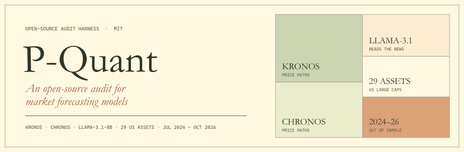
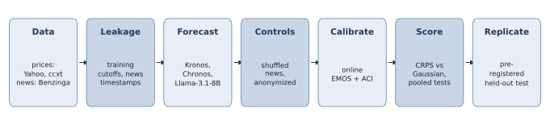
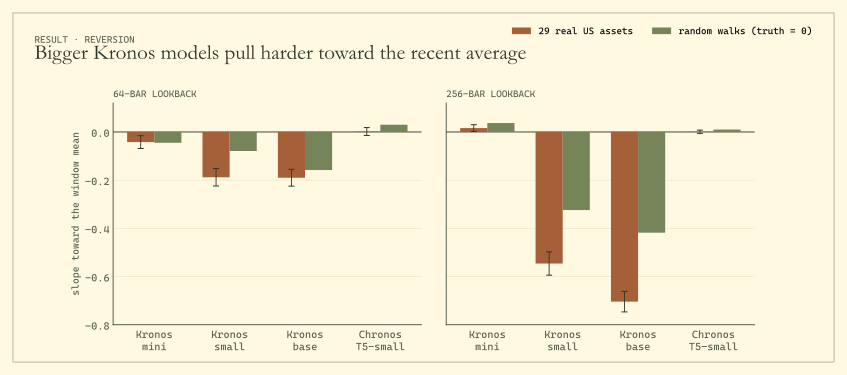
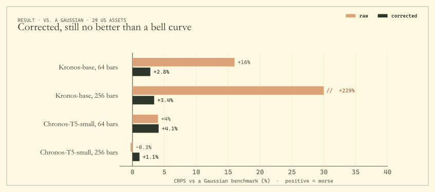
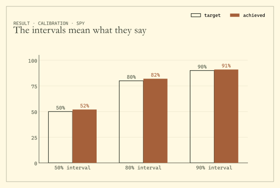
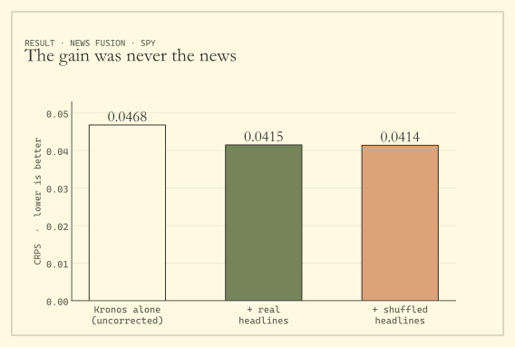
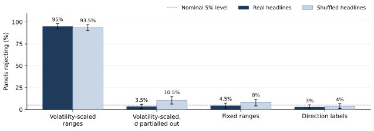

<p align="center">
  
</p>

<p align="center">
  
  
  
  
</p>

<p align="center">
  <b>Can an AI model predict the market?</b><br>
  P-Quant tests three of them with the same checks and reports what holds up.
</p>

<p align="center">
  <a href="#what-this-is">What this is</a> ·
  <a href="#the-checks">The checks</a> ·
  <a href="#results">Results</a> ·
  <a href="#run-it">Run it</a> ·
  <a href="#pre-registrations">Pre-registrations</a> ·
  <a href="#contributing">Contributing</a> ·
  <a href="#reference">Reference</a>
</p>

---

## What this is

Two kinds of AI model are now used to forecast markets without any extra training:

- **Price models** (Kronos, Chronos) look at a stock's recent prices and sample possible futures.
- **News readers** (here Llama-3.1-8B) read the day's headlines and say which way the stock should move.

Results that look good can still be wrong. The model may have seen the answers during training, a headline
may leak tomorrow's news, or the way the question is asked may create a signal by itself. P-Quant is a
harness that checks for all three.

I started out trying to combine price forecasts and news into one better forecast. The checks kept showing
that the improvements were not real.

> **Short version:** with the checks in place, none of the models gave a forecasting edge that held up. The
> one signal that looked real came from the way the question was asked.

| Role | Model | How it is used |
|---|---|---|
| Price model | [Kronos](https://github.com/shiyu-coder/Kronos) base, small, mini (102M, 24.7M, 4.1M parameters) | no extra training, 32 sampled price paths per forecast, fp16 on a T4 GPU |
| Comparison | Chronos-T5-small (46M) | same sampling and scoring as Kronos |
| News reader | Llama-3.1-8B-Instruct, 4-bit | up to 25 Benzinga headlines that were public in time; answers read as next-token probabilities |
| Benchmarks | bell curve with recent volatility, bootstrap, random walk | simple forecasts on the same dates, as a reference |

**Assets.** SPY, QQQ, IWM and 26 large US stocks on daily data, forecasting 5 days ahead; BTC and ETH on hourly
data, forecasting 24 hours ahead. All main results use forecasts from **July 2024 to October 2026**, after both
models' training data ends.

## The checks

<p align="center"></p>

| Check | What it rules out | Code |
|---|---|---|
| **Training cutoffs.** Kronos's training data ends in June 2024 and Llama's in December 2023. Only forecasts from July 2024 on count. The year before is kept for comparison. | the model remembering the answer | `config.py`, `data.py` |
| **News timing.** A headline is used only if it was written *and last edited* before the forecast. Edited articles are dropped, not trimmed. | tomorrow's news leaking in through edits | `news.py` |
| **Shuffled news.** Every forecast is rerun with headlines from a random other day. A real news effect should disappear. | effects that have nothing to do with the news | `news_scoring.py` |
| **Answer shuffle.** The LLM's answers are moved to random other days while each day keeps its own volatility. | signals that come from how the answers are scaled | `vol_artifact.py` |
| **Anonymised prompts.** Company names, tickers, people and dates are removed. | the model recognising the company instead of reading the story | `llm.py`, `news_scoring.py` |
| **Online corrections.** Any correction uses only outcomes already known at forecast time. | corrections that peek at the future | `calibration.py` |
| **Pre-registration.** The hypothesis, data and test are written down and dated, and the code frozen by hash, before scoring. | changing the test after seeing the results | `PREREGISTRATION*.md`, `prereg_tests.py` |

Forecasts are scored with CRPS (lower is better), interval coverage and PIT. Signals are scored with the
information coefficient (IC), the correlation between forecast and outcome. The statistical tests are listed
in [Reference](#reference).

## Results

### 1. Kronos keeps betting prices will snap back

<p align="center"></p>

Kronos pulls its forecasts back toward the average price of the window it was shown. On SPY with a 256-day
window the slope is **−0.64**. The tokenizer is not the cause: it rebuilds prices to within 0.09%. The pull shows
up even on random walks, where the past says nothing about the future: there Kronos bets against the true
trend in **98–100%** of cases. Bigger Kronos models pull harder. Chronos doesn't pull at all.

| Model | 64 days, real (t) | 256 days, real (t) | 256 days, random walks |
|---|---:|---:|---:|
| Kronos-mini, 4.1M | −0.04 (−3.2) | +0.02 (2.3) | +0.04 |
| Kronos-small, 24.7M | −0.19 (−10.4) | −0.55 (−22.6) | −0.32 |
| Kronos-base, 102M | −0.19 (−10.9) | −0.70 (−33.1) | −0.42 |
| Chronos-T5-small | +0.002 (0.2) | +0.001 (0.3) | +0.01 |

<sub>Slope 0 means no pull. t-statistics use Driscoll–Kraay standard errors. Kronos-mini uses a different tokenizer, so the fair size comparison is small vs base. Exploratory, not pre-registered.</sub>

### 2. Once corrected, Kronos is honest but no better than a bell curve

<p align="center"></p>

A running correction removes the bias. Uncorrected Kronos with a 256-day window has **229%** more error than a
plain bell-curve forecast. Corrected, the gap shrinks to **3.4%**, but it never closes. Across 29 US assets, no
corrected model beats the bell curve.

<table>
<tr>
<td width="50%"></td>
<td width="50%"></td>
</tr>
<tr>
<td><sub>After correction on SPY, the 50%, 80% and 90% ranges contain 52%, 82% and 91% of outcomes.</sub></td>
<td><sub>Adding the news cut the error from 0.0468 to 0.0415, but headlines from the wrong day did the same. The blend was cancelling Kronos's bias, not reading the news.</sub></td>
</tr>
</table>

### 3. Asking the wrong way creates a signal from nothing

<p align="center"></p>

If you ask the LLM to pick from return ranges that get wider when a stock is jumpy, its habit of leaning
bearish turns into a copy of volatility (correlation **−0.50**). Volatility itself weakly predicts returns, so
this looks like a news signal. It shows up even with shuffled headlines, and in simulated markets where the
LLM knows nothing, the test still finds a "signal" **95%** of the time. Fixed-size ranges or plain up/down labels
remove it.

The two lines behind it: the implied forecast is volatility times the model's average lean, so its
correlation with future returns is just volatility's correlation, with the lean's sign.

$$
\mathbb{E}_{q_t}[r] = \sigma_t\, m(q_t), \qquad
\mathrm{corr}\big(\mathbb{E}_{q_t}[r],\, r_{t+h}\big) = \mathrm{sign}\big(m(q)\big)\cdot \mathrm{corr}\big(\sigma_t,\, r_{t+h}\big)
$$

### 4. Two pre-registered tests, both negative

The contrarian news signal from the early work was tested twice on new data, with the test fixed in advance.
It failed on 10 held-out assets (Holm p = 0.056, and the placebo was just as significant). With the scaling
problem removed, it found nothing on 20 new large caps (IC +0.005, one-sided p = 0.60).

## Run it

```bash
git clone https://github.com/TanmayCJ/P-Quant && cd P-Quant
pip install -e ".[data,stats]"
python -m tests.run_all          # 47 tests, CPU only, no keys or internet needed
```

The tests use a fake model and made-up prices. They cover the metrics, resumable sampling, picking headlines
safely, calibration, news fusion, the pre-registered tests, the scaling simulation and the reports.

Three results you can reproduce on a laptop, with no data:

```bash
python scripts/run_vol_artifact.py --simulate --seeds 200      # the 95% false-alarm simulation
python scripts/run_vol_artifact.py --grid --seeds 50           # false alarms by rebound strength and lean
python scripts/sim_permutation_size.py 200 2000            # how often the pooled tests cry wolf
```

**The full study** runs on free Colab T4 GPUs, about 16–17 GPU-hours in total, and every notebook picks up
where it left off after a disconnect. Zip this folder as `kronos-agent.zip` and upload it to
`MyDrive/kronos-agent/`. Notebooks 03–06 also need the Colab Secrets `ALPACA_API_KEY`, `ALPACA_SECRET_KEY` and
`HF_TOKEN`. Run the notebooks in order.

| Notebook | Result | What it does | Needs |
|---|:---:|---|---|
| `01_sample_kronos` | 1, 2 | Kronos forecasts for SPY and BTC, baselines, running correction | T4 |
| `02_diagnose_bias` | 1 | the snap-back, tokenizer check, window length | T4 |
| `03_news_llm` | 2 | fetch news, LLM scoring, blend news into the forecast | T4 + keys |
| `04_prereg1` | 4 | pre-registration 1 | T4 + keys |
| `05_vol_artifact` | 3 | the scaling problem, three ways of asking | T4 + keys |
| `06_prereg2` | 4 | pre-registration 2 | T4 + keys |
| `07_cross_asset` | 1, 2 | 29 US assets and ETH, Chronos comparison, random walks | T4 |
| `08_diagnostics` | 2, 4 | spread-estimator check, permutation p-values | CPU |
| `09_export_dashboard` | – | exports results for the dashboard | CPU |
| `10_model_size` | 1 | Kronos mini vs small vs base | T4 |
| `11_slope_inference` | 1 | significance tests for the snap-back slopes | CPU |

<sub>Sampling is seeded, but fp16 GPU sampling is not bit-identical across hardware, so reruns can differ in the last digit.</sub>

## Pre-registrations

Both confirmation tests were written down, dated and frozen before any new data was scored.

| File | Hypothesis | Code hash | Result |
|---|---|---|---|
| `PREREGISTRATION.md` | The expected return from volatility-scaled ranges is negatively correlated with the actual return (8 stocks, BTC, ETH) | `126982343bb64796` | not confirmed |
| `PREREGISTRATION_2.md` | P(up) − P(down) from up/down labels is negatively correlated with the 5-day return (20 new large caps) | `fedc56a9cea61e65` | not confirmed |

The frozen code is attached to the [v1.0.0 release](https://github.com/TanmayCJ/P-Quant/releases/tag/v1.0.0)
as `P-Q-Agent-prereg1.zip` and `P-Q-Agent-prereg2.zip`. The code in this repo is newer than both, and files
have since been renamed: the archives (and the two PREREGISTRATION files) use the old names, e.g. `kronos_agent/`
for `pquant/`, `confirm.py` for `prereg_tests.py` and `configs/confirm/` for `configs/prereg1/`. The
cross-asset study, model-size comparison, slope tests, answer shuffle and grid came later and are exploratory.

## Contributing

Every new model, asset or setting the audit runs on makes it more useful. You can add:

| What | What you send | Where |
|---|---|---|
| **An audit run** | your config, the `metrics.csv` and `tests.csv` it wrote, and a short provenance sheet | [`contrib/runs/`](contrib/) |
| **Tests** | tests on made-up data that need no internet or GPU | [`tests/`](tests/) |
| **Code** | fixes, baselines, model adapters, metrics | [`pquant/`](pquant/) |

Negative results count as much as positive ones. Commit results only, never raw prices, news or model outputs,
and only score dates after the model's training cutoff.

Start with [`CONTRIBUTING.md`](CONTRIBUTING.md): it has the setup, the steps and the **contribution terms**.
To plan a run first, open a
[*Propose an audit run*](https://github.com/TanmayCJ/P-Quant/issues/new?template=audit_run.yml) issue.
Everyone follows the [Code of Conduct](CODE_OF_CONDUCT.md). Report security problems as described in
[`SECURITY.md`](SECURITY.md).

## Reference

<details>
<summary><b>How the repo is organised</b></summary>

```
pquant/        the library: everything the scripts and notebooks import
scripts/       one command per step (run_*.py); all resume and all take --root
configs/       one YAML file per asset, grouped by study
notebooks/     Colab notebooks, one per study, in run order
tests/         47 tests, CPU only, fake models and made-up data
docs/img/      README figures (python scripts/make_readme_figures.py redraws them)
contrib/runs/  audit runs sent in by contributors
```

**`pquant/`, grouped by job**

| Job | File | What it does |
|---|---|---|
| Setup | `config.py` | loads a YAML config on top of the defaults |
| | `data.py` | downloads and caches prices, builds the list of forecast dates |
| | `store.py` | append-only result files that survive Colab disconnects |
| Forecasting | `sampler.py` | Kronos: samples price paths (Kronos itself is unmodified) |
| | `baselines.py` | Chronos, with the same interface as Kronos |
| | `pipeline.py` | runs a model over every forecast date and saves the paths |
| Scoring | `metrics.py` | CRPS, PIT, coverage, IC, Diebold–Mariano and standard errors |
| | `evaluate.py` | scores Kronos against the bell-curve, bootstrap and random-walk baselines |
| | `calibration.py` | running corrections (EMOS, ACI, conformal) that only use past outcomes |
| | `policy.py` | trade-or-abstain rule and a backtest with costs (early work only) |
| News and LLM | `news.py` | fetches headlines and keeps only those public in time |
| | `llm.py` | builds the prompts and reads the LLM's probability for each answer |
| | `news_scoring.py` | runs the LLM over every forecast date (real, anonymised, shuffled news) |
| | `fusion.py` | blends Kronos's paths with the LLM's probabilities |
| Studies | `calibration_report.py` | does correcting Kronos fix it? |
| | `news_fusion_report.py` | does adding news help? |
| | `cross_asset.py` | Kronos and Chronos across 29 assets, plus the random-walk test |
| | `vol_artifact.py` | the volatility-scaling trap: breakdown, answer shuffle, simulation |
| | `prereg_tests.py` | the pre-registered tests: pooled IC, placebo, Holm, permutations |
| Output | `export.py` | packs results for the dashboard |

**`configs/`**

| Folder | Used by |
|---|---|
| `spy_1d.yaml`, `btc_1h.yaml` | the first Kronos and news experiments |
| `prereg1/`, `prereg2/` | the two pre-registered tests |
| `vol_artifact/` | the volatility-scaling study (SPY; the other 8 assets come from `prereg1/`) |
| `cross_asset/`, `cross_asset_crypto/` | the 29-asset and ETH study |

Two output folders keep their original names (`reports/phaseb/` and the `phase3_*.csv` files) so results saved
before the rename still load.
</details>

<details>
<summary><b>Terms used here</b></summary>

| Term | Meaning |
|---|---|
| CRPS | error score for a whole forecast distribution; lower is better |
| Coverage | share of outcomes that land inside a forecast range (an honest 80% range catches about 80%) |
| PIT | check of whether outcomes are spread evenly across the forecast distribution |
| IC | correlation between a forecast and what actually happened, from −1 to +1 |
| σ (volatility) | typical size of recent price moves |
| Placebo | a fake input (like the wrong day's news) that should make a real effect disappear |
| EMOS | a running correction that re-centres and re-scales the forecast using past errors |
| Diebold–Mariano | test of whether one forecast's error is really lower than another's |
| Newey–West, Driscoll–Kraay | ways to compute standard errors when observations overlap or share dates |
| Holm | stricter p-values when testing several things at once |
</details>

<details>
<summary><b>The maths</b></summary>

**Window-mean gap.** How far the last price is above the average (log) price of the window; the snap-back slope
$b$ measures how much the forecast leans against it.

$$
g_t = \log P_t - \frac{1}{L}\sum_{s=t-L+1}^{t}\log P_s, \qquad \mu_t = a + b\,g_t + \varepsilon_t
$$

**Running correction** (`calibration.py`). Each sampled path is re-centred and re-scaled using only past outcomes:
ridge weights over the last 250 known results, and a spread factor $k_t = \sqrt{\overline{(e/s)^2}}$.

$$
\tilde{x}_{t,j} = \alpha_t + \beta_t\,\mu_t + \gamma_t\,g_t + k_t\,(x_{t,j} - \mu_t)
$$

**Score.** CRPS, compared with a bell-curve benchmark $N(0, \hat\sigma_t^2 h)$:

$$
\mathrm{CRPS}(F, y) = \mathbb{E}_F\lvert X - y\rvert - \tfrac{1}{2}\,\mathbb{E}_F\lvert X - X'\rvert
$$

**Pooled news test** (`prereg_tests.py`, one-sided, Newey–West) and **slope standard errors clustered by date**
(`cross_asset.py`):

$$
d_t = \frac{1}{N_t}\sum_{i=1}^{N_t} z(\text{signal}_{it})\, z(r_{i,t+h}), \qquad
\widehat{\mathrm{Var}}(\bar b) = \sum_{\ell=-m}^{m}\Big(1 - \frac{|\ell|}{m+1}\Big)\sum_t u_t\,u_{t-\ell}
$$
</details>

<details>
<summary><b>Install options</b></summary>

```bash
pip install -e .                     # core: numpy, pandas, pyarrow, pyyaml
pip install -e ".[data,stats]"       # price data (yfinance, ccxt) and scipy
pip install -e ".[model,chronos]"    # Kronos / Chronos sampling (GPU recommended)
pip install -e ".[llm]"              # LLM scoring in 4-bit (needs a CUDA GPU)
```

Kronos is not included. Clone it next to this repo and point the sampling script at it:

```bash
git clone https://github.com/shiyu-coder/Kronos
python scripts/run_sampling.py --root results --kronos-path Kronos --config configs/spy_1d.yaml
```

Results go under the root you choose: `data/` (cached prices), `paths/<run tag>/part-*.parquet` (sampled paths;
the tag includes the asset, model and window length, so runs never mix) and `reports/<study>/`.
</details>

<details>
<summary><b>Data, keys and licences</b></summary>

- **No data is included.** No prices, headlines, LLM scores or sampled paths are in this repo. Prices come from
  Yahoo Finance (yfinance) and exchanges (ccxt). Headlines come from the Alpaca news API (Benzinga), which needs
  your own Alpaca account.
- **Keys** are read only from environment variables or Colab Secrets, never stored in the code.
- **Model licences:** Kronos (MIT), Chronos (Apache-2.0) and Llama-3.1 (Meta Llama 3.1 Community Licence; accept
  it on Hugging Face first) keep their own terms.
- P-Quant itself is MIT licensed (`LICENSE`).

This is research code for testing forecasts. It is not investment advice and not meant for trading.
</details>

<details>
<summary><b>Known limitations</b></summary>

- yfinance `auto_adjust=True` applies today's split and dividend adjustments to past prices. Data is cached once,
  and evaluation refuses to run if the cache changes.
- Future bar dates (the calendar only, no prices) come from the data. They are known in advance except for
  unplanned market closures.
- CRPS uses the standard ensemble estimate, which is slightly biased for small ensembles. Every method uses the
  same number of samples, so comparisons stay fair.
- Benzinga covers several large caps thinly, which weakens pre-registration 2.
- Only one open 8B model, reading headlines only. Bigger models or full articles may behave differently.
</details>

<details>
<summary><b>Cite this software</b></summary>

```bibtex
@software{jain2026pquant,
  title   = {{P-Quant}: an audit harness for LLM news signals and financial foundation models},
  author  = {Jain, Tanmay C.},
  year    = {2026},
  version = {1.0.0},
  url     = {https://github.com/TanmayCJ/P-Quant}
}
```

Machine-readable metadata is in `CITATION.cff`.
</details>

---

<p align="center">
  <sub>Built by <a href="https://github.com/TanmayCJ">TanmayCJ</a> · MIT licence</sub>
</p>
