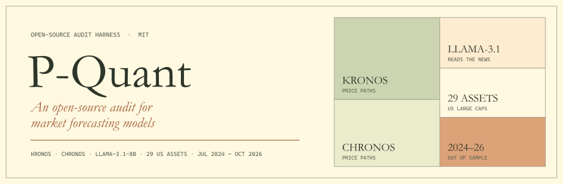
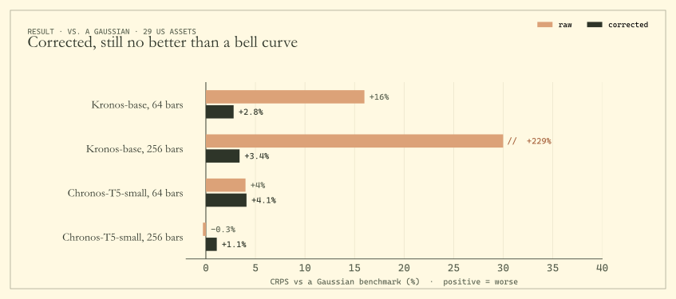
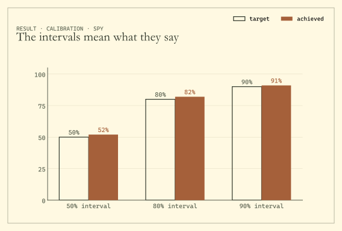
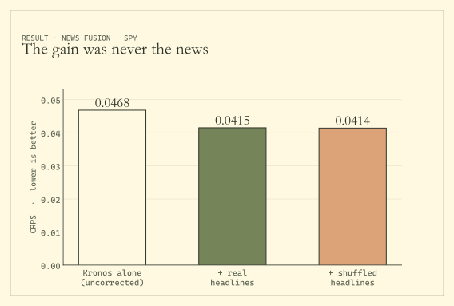

<p align="center">
  
</p>

<p align="center">
  
  
  
  
  
</p>

<p align="center">
  <b>Can a model predict the market?</b><br>
  <i>P-Quant puts three of them through the same controls and reports what survives.</i>
</p>

<p align="center">
  <a href="#the-idea">The idea</a> ·
  <a href="#the-controls">The controls</a> ·
  <a href="#what-we-found">What we found</a> ·
  <a href="#the-method">The method</a> ·
  <a href="#run-it">Run it</a> ·
  <a href="#pre-registrations">Pre-registrations</a> ·
  <a href="#contributing">Contributing</a> ·
  <a href="#reference">Reference</a>
</p>

---

## The idea

Two kinds of model now forecast markets straight out of the box. **Kronos** and **Chronos** read price
charts and sample possible futures. **Llama-3.1-8B** reads the day's headlines and says which way it thinks a
stock will move. Each arrives with impressive numbers attached.

Impressive numbers are cheap. A model may have seen the answers during training, a headline may leak
tomorrow's news, or the way a question is phrased may create a signal on its own. P-Quant is the harness that
checks for all three. It started as an attempt to fuse price paths with news into one sharper forecast. The
controls kept catching gains that were not real.

> **The short version.** Under the controls, none of the models gave a forecasting edge that held up, and the
> one signal that looked real came from how the question was asked.

| | Model | How it is used |
|---|---|---|
| **Price model** | [Kronos](https://github.com/shiyu-coder/Kronos) base · small · mini (102M · 24.7M · 4.1M) | zero-shot, 32 sampled price paths per forecast, fp16 on a T4 |
| **Comparison** | Chronos-T5-small (46M) | same sampling interface and scoring as Kronos |
| **News reader** | Llama-3.1-8B-Instruct, 4-bit | up to 25 leakage-safe Benzinga headlines; answers read as next-token probabilities |
| **Benchmarks** | Gaussian with recent volatility · bootstrap · random walk | simple, calibrated references on the same dates |

**Universe.** SPY, QQQ, IWM and 26 US large caps on daily bars at a 5-day horizon, plus BTC and ETH on hourly
bars at 24 hours. Every headline result is scored **July 2024 to October 2026**, after both models stopped
learning.

## The controls

<p align="center"></p>

| Control | What it rules out | Where in the code |
|---|---|---|
| **Two training cutoffs.** Kronos stops in 2024-06 and Llama-3.1 in 2023-12; only forecasts from 2024-07 count, and the year before stays as an in-sample contrast. | answers memorized in training | `config.py`, `data.py` |
| **News timing.** A headline counts only if it was created *and last edited* before the decision time. Edited articles are dropped, not trimmed. | look-ahead through late edits | `news.py` |
| **Shuffled-news placebo.** Every forecast is re-run with another day's headlines. A real news effect has to disappear. | effects that have nothing to do with news | `newsrun.py` |
| **Anonymized prompts.** Company names, tickers, people and dates are removed. | recalling the company instead of reading the story | `llm.py`, `newsrun.py` |
| **Online calibration.** Every correction uses only outcomes already known at forecast time. | calibration that peeks at the future | `conformal.py`, `phase2.py` |
| **Pre-registration.** Hypothesis, data and test are fixed in a dated file, with the code frozen by hash, before scoring. | moving the goalposts | `PREREGISTRATION*.md`, `confirm.py` |

Distributions are scored with CRPS, interval coverage and PIT; signals with the information coefficient.
Significance comes from Diebold–Mariano tests with Newey–West variance, pooled tests across assets,
Driscoll–Kraay standard errors, Holm corrections and permutation tests.

## What we found

### 1 · Kronos keeps betting on a snap-back

<p align="center"></p>

Kronos pulls its forecasts back toward the average price of the window it was shown. On SPY at a 256-bar
lookback the slope is **−0.64**, and the tokenizer is not to blame: it rebuilds prices within 0.09%. The pull
shows up even on pure random walks, where Kronos forecasts against the true trend in **98–100%** of series.
Bigger Kronos models pull harder; Chronos does not pull at all.

| Model | 64 bars, real (t) | 256 bars, real (t) | 256 bars, random walks |
|---|---:|---:|---:|
| Kronos-mini · 4.1M | −0.04 (−3.2) | +0.02 (2.3) | +0.04 |
| Kronos-small · 24.7M | −0.19 (−10.4) | −0.55 (−22.6) | −0.32 |
| Kronos-base · 102M | −0.19 (−10.9) | −0.70 (−33.1) | −0.42 |
| Chronos-T5-small | +0.002 (0.2) | +0.001 (0.3) | +0.01 |

<sub>Driscoll–Kraay t-statistics. Kronos-mini uses a different tokenizer, so the clean size comparison is small against base. Exploratory, not pre-registered.</sub>

### 2 · Fixed, it is calibrated, but no better than a bell curve

<p align="center"></p>

An online correction removes the bias. Raw Kronos at 256 bars is **229%** worse than a plain Gaussian; corrected,
the gap shrinks to **3.4%**, and it never closes. Across 29 US assets, no corrected model beats the benchmark.

<table>
<tr>
<td width="50%"></td>
<td width="50%"></td>
</tr>
<tr>
<td><sub>After correction on SPY, the 50%, 80% and 90% intervals cover 52%, 82% and 91% of outcomes.</sub></td>
<td><sub>Adding the news reading cut error from 0.0468 to 0.0415. Shuffled headlines did the same: the fusion was fixing Kronos's bias, not reading news.</sub></td>
</tr>
</table>

### 3 · Ask the wrong way and you get a signal from nothing

<p align="center"></p>

Ask the model for probabilities over return ranges that scale with recent volatility, and its habitual
bearishness turns into a volatility signal (correlation **−0.50**). That signal looks significant even with
shuffled headlines, and it fires in **95%** of simulated markets that contain no information at all. Fixed
ranges or plain up/down labels make it go away.

$$
\mathbb{E}_{q_t}[r] = \sigma_t\, m(q_t), \qquad
\mathrm{corr}\big(\mathbb{E}_{q_t}[r],\, r_{t+h}\big) = \mathrm{sign}\big(m(q)\big)\cdot \mathrm{corr}\big(\sigma_t,\, r_{t+h}\big)
$$

### 4 · Two pre-registered replications

The contrarian news signal that came out of the exploratory work was tested twice on fresh data, with the
test fixed in advance. It missed on 10 held-out assets (Holm p = 0.056, with the placebo just as significant),
and with the artifact removed it found nothing on 20 new large caps (IC +0.005, one-sided p = 0.60).

## The method

**Window-mean gap.** For a forecast at $t$ with lookback $L$ and last close $P_t$, and the reversion slope $b$:

$$
g_t = \log P_t - \frac{1}{L}\sum_{s=t-L+1}^{t}\log P_s, \qquad \mu_t = a + b\,g_t + \varepsilon_t
$$

**Online correction** (`conformal.py`). Each sampled path $x_{t,j}$ is re-centred and re-scaled using only past
outcomes: ridge weights over the last 250 realized forecasts, and a spread factor $k_t = \sqrt{\overline{(e/s)^2}}$.

$$
\tilde{x}_{t,j} = \alpha_t + \beta_t\,\mu_t + \gamma_t\,g_t + k_t\,(x_{t,j} - \mu_t)
$$

**Score.** The continuous ranked probability score against a benchmark of $N(0, \hat\sigma_t^2 h)$:

$$
\mathrm{CRPS}(F, y) = \mathbb{E}_F\lvert X - y\rvert - \tfrac{1}{2}\,\mathbb{E}_F\lvert X - X'\rvert
$$

**Pooled news test** (`confirm.py`), one-sided with Newey–West, and **date-clustered slopes** (`phaseb.py`):

$$
d_t = \frac{1}{N_t}\sum_{i=1}^{N_t} z(\text{signal}_{it})\, z(r_{i,t+h}), \qquad
\widehat{\mathrm{Var}}(\bar b) = \sum_{\ell=-m}^{m}\Big(1 - \frac{|\ell|}{m+1}\Big)\sum_t u_t\,u_{t-\ell}
$$

## Run it

```bash
git clone https://github.com/TanmayCJ/P-Quant && cd P-Quant
pip install -e ".[data,stats]"
python -m tests.run_all          # 44 tests · CPU only · no keys, no network
```

The tests use a fake predictor and synthetic prices. They cover the metrics, resumable sampling, leakage-safe
news selection, calibration, fusion, the pre-registered tests, the artifact simulation and the reports.

Two results reproduce on any laptop, no data needed:

```bash
python scripts/run_artifact.py --simulate --seeds 200      # the 95% false-positive simulation
python scripts/sim_permutation_size.py 200 2000            # size of the pooled tests
```

**The full study** runs on free Colab T4s, about 16–17 GPU-hours in all, and every notebook resumes after a
disconnect. Zip this folder as `kronos-agent.zip`, upload it to `MyDrive/kronos-agent/`, add the Colab
Secrets `ALPACA_API_KEY`, `ALPACA_SECRET_KEY` and `HF_TOKEN` for notebooks 03–06, and run in order.

| Notebook | Finding | What it does | Runs on |
|---|:---:|---|---|
| `01_sample_kronos` | 1 · 2 | Kronos path sampling on SPY and BTC, baselines, online calibration | T4 |
| `02_diagnose_bias` | 1 | window-mean reversion, tokenizer round-trip, lookback sensitivity | T4 |
| `03_news_llm` | 2 | news retrieval, Llama scoring, fusing news into the forecast | T4 + keys |
| `04_confirm` | 4 | pre-registration 1 | T4 + keys |
| `05_artifact` | 3 | volatility-scaling artifact, three elicitation modes | T4 + keys |
| `06_confirm2` | 4 | pre-registration 2 | T4 + keys |
| `07_phaseb` | 1 · 2 | 29 US assets and ETH, Chronos comparison, random walks | T4 |
| `08_diagnostics` | 2 · 4 | spread-estimator sensitivity, permutation p-values | CPU |
| `09_export_dashboard` | – | exports results for the companion dashboard | CPU |
| `10_model_size` | 1 | Kronos mini / small / base comparison | T4 |
| `11_slope_inference` | 1 | date-clustered tests of the reversion slopes | CPU |

<sub>Sampling is seeded, but fp16 GPU sampling is not bit-identical across hardware, so reruns can differ in the last digit.</sub>

## Pre-registrations

Both confirmatory tests were written down, dated and frozen before any held-out data were scored.

| File | Hypothesis | Code hash | Result |
|---|---|---|---|
| `PREREGISTRATION.md` | Expected return from volatility-scaled ranges is negatively correlated with the realized return (8 equities, BTC, ETH) | `126982343bb64796` | not confirmed |
| `PREREGISTRATION_2.md` | P(up) − P(down) from direction labels is negatively correlated with the 5-day return (20 new large caps) | `fedc56a9cea61e65` | not confirmed |

The frozen code archives, `P-Q-Agent-prereg1.zip` and `P-Q-Agent-prereg2.zip`, are attached to the
[v1.0.0 release](https://github.com/TanmayCJ/P-Quant/releases/tag/v1.0.0). The code here is newer than both;
the cross-asset study, model-size comparison and date-clustered slopes came later and are exploratory.

## Contributing

The audit gets stronger with every model, asset and setting it is run on. Contributions are welcome:

| You can add | What you send | Where |
|---|---|---|
| **An audit run** | your config, the `metrics.csv` and `tests.csv` the harness wrote, and a provenance sheet | [`contrib/runs/`](contrib/) |
| **Tests** | deterministic tests on synthetic data, no network or GPU | [`tests/`](tests/) |
| **Code** | fixes, baselines, model adapters, metrics | [`kronos_agent/`](kronos_agent/) |

Null and negative results count as much as positive ones. Commit results only, never raw prices,
news or model outputs, and score only windows after the model's training cutoff.

Start with [`CONTRIBUTING.md`](CONTRIBUTING.md), which includes the setup, the run steps and the
**contribution terms**. To plan a run first, open a
[*Propose an audit run*](https://github.com/TanmayCJ/P-Quant/issues/new?template=audit_run.yml) issue.
Everyone follows the [Code of Conduct](CODE_OF_CONDUCT.md); security problems go to
[`SECURITY.md`](SECURITY.md).

## Reference

<details>
<summary><b>Repository layout</b></summary>

```
kronos_agent/          the package
  sampler.py           Kronos path sampling (N single-sample calls; upstream Kronos is left unmodified)
  baselines.py         Chronos with the same sampling interface
  pipeline.py, store.py  resumable sampling into an append-only Parquet store (survives Colab disconnects)
  data.py              market data loading, caching, forecast-origin grids
  evaluate.py          Kronos vs Gaussian / bootstrap / random-walk baselines, pre vs post cutoff
  conformal.py         online, delay-aware EMOS, ACI and conformal calibration
  policy.py            trade-or-abstain policy and cost-aware backtest (early phases only)
  news.py, newsrun.py  Alpaca/Benzinga news, leakage-safe headline selection, per-origin LLM scoring
  llm.py               prompts and next-token probability readout over answer letters A..G
  fusion.py            log-linear pooling of ensemble paths with LLM probabilities
  confirm.py           pre-registered pooled IC tests, placebo, Holm, permutation tests
  artifact.py          volatility-scaling artifact: decomposition and simulation
  phase2.py, phase3.py, phaseb.py  reports for calibration, fusion and the cross-asset / synthetic study
  metrics.py           CRPS, PIT, coverage, IC, Diebold–Mariano, HAC and Driscoll–Kraay SEs, bootstrap
  export.py            packs results for the companion dashboard
scripts/               command-line entry points (one per stage; all resumable, all take --root)
configs/               one YAML per asset and study (exploratory, confirm/, artifact/, confirm2/, kronos_b/)
notebooks/             Colab drivers, one per stage
tests/                 44 unit tests, CPU only, fake models and synthetic data
docs/img/              README figures (python scripts/make_readme_figures.py redraws them)
```
</details>

<details>
<summary><b>Install options</b></summary>

```bash
pip install -e .                     # core: numpy, pandas, pyarrow, pyyaml
pip install -e ".[data,stats]"       # price data (yfinance, ccxt) and scipy
pip install -e ".[model,chronos]"    # Kronos / Chronos sampling (GPU recommended)
pip install -e ".[llm]"              # Llama scoring in 4-bit (needs a CUDA GPU)
```

Kronos is not vendored. Clone it next to this repo and point the sampling scripts at it:

```bash
git clone https://github.com/shiyu-coder/Kronos
python scripts/run_sampling.py --root results --kronos-path Kronos --config configs/spy_1d.yaml
```

Results land under the chosen root: `data/` (cached prices), `paths/<run tag>/part-*.parquet` (sampled paths; the
tag encodes asset, model and lookback, so runs never mix) and `reports/<study>/`.
</details>

<details>
<summary><b>Data, keys and licences</b></summary>

- **No data is redistributed.** No prices, headlines, LLM scores or sampled paths live in this repo. Prices come
  from Yahoo Finance (yfinance) and exchanges (ccxt); headlines from the Alpaca news API (Benzinga), which needs
  your own Alpaca account.
- **Keys** are read only from environment variables or Colab Secrets. None are stored in the code.
- **Model licences:** Kronos (MIT), Chronos (Apache-2.0) and Llama-3.1 (Meta Llama 3.1 Community Licence; accept
  it on Hugging Face first) keep their own terms.
- P-Quant itself is released under the MIT licence (`LICENSE`).

This is research code for evaluating forecasts. It is not investment advice and is not meant for trading.
</details>

<details>
<summary><b>Known limitations</b></summary>

- yfinance `auto_adjust=True` applies today's split and dividend adjustments to history. Data is cached once, and
  evaluation refuses to run if the cache changes.
- Future bar timestamps (the calendar only) come from the data; they are known in advance except for unscheduled closures.
- CRPS uses the standard ensemble estimator, which is biased at small ensembles. Every method uses the same
  number of samples, so comparisons stay fair.
- Benzinga coverage is thin for several large caps, which lowers the power of pre-registration 2.
- One open 8B model reading headlines only. Larger models or full articles may behave differently.
</details>

<details>
<summary><b>Cite this software</b></summary>

```bibtex
@software{jain2026pquant,
  title   = {{P-Quant}: an audit harness for LLM news signals and financial foundation models},
  author  = {Jain, Tanmay C.},
  year    = {2026},
  version = {1.0.0},
  url     = {https://github.com/TanmayCJ/P-Quant}
}
```

Machine-readable metadata is in `CITATION.cff`.
</details>

---

<p align="center">
  <sub><b>Built by <a href="https://github.com/TanmayCJ">TanmayCJ</a></b> · MIT licence · <i>Audit the forecast before you trust it.</i></sub>
</p>
